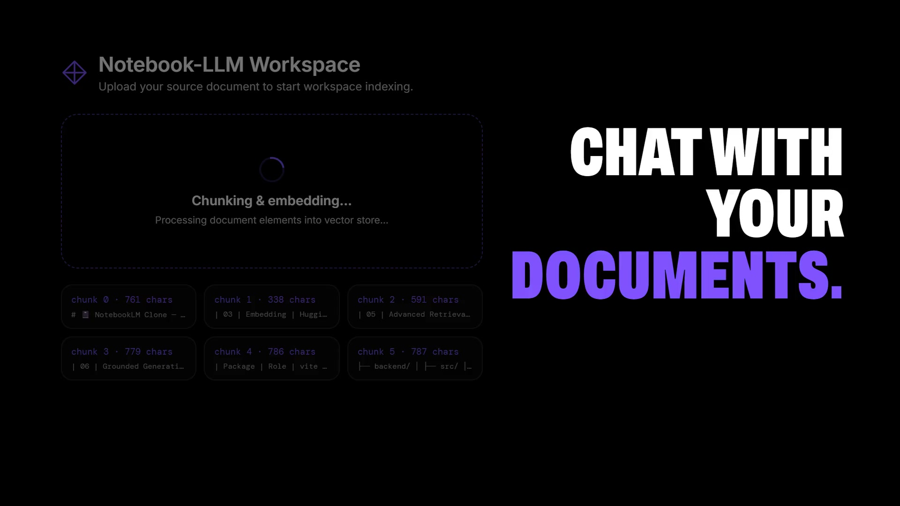

# 📓 NotebookLM Clone — RAG Application

> A full RAG pipeline application where users can upload documents and chat with them.

🔗 **Live Demo:** [rag-notebook-lm.netlify.app](https://rag-notebook-lm.netlify.app/)

<p align="center">
  <a href="https://mohitsagar11.github.io/videos/notebooklm.mp4">
    
  </a>
  <br>
  <sub>▶ 20-second demo (click the image to play) · file: <a href="docs/demo.mp4"><code>docs/demo.mp4</code></a></sub>
</p>

---

## Advanced RAG Pipeline   

| Step | Stage | Description |
|------|-------|-------------|
| 01 | **Ingestion** | User uploads a PDF or `.txt` file. Text is extracted from PDFs page-by-page using `pdfjs-dist` to optimize memory usage. |
| 02 | **Chunking** | Custom Recursive Character Splitter — 800-character chunks with 150-character overlap. Splits recursively on separators (paragraphs, newlines, sentences, and spaces) to preserve context. Each chunk includes metadata: `{ source, chunkIndex, totalChunks, charCount }`. |
| 03 | **Embedding** | `sentence-transformers/all-MiniLM-L6-v2` runs locally in the backend via `@huggingface/transformers` (quantized ONNX), producing 384-dim normalized vectors in batches of 32. No embedding API key or inference credits needed. |
| 04 | **Storage** | Pinecone serverless index. Chunks are stored in a dedicated document-level namespace to ensure clean isolation between different uploads. |
| 05 | **Advanced Retrieval** | **1. Query Expansion**: The original question is expanded into 3 variants (1 original + 2 rephrasings) using `gpt-oss-120b` via OpenRouter to maximize recall.<br>**2. Multi-Query Search**: Similarity search (Top-K=5) is performed for all 3 variants in Pinecone, and candidate results are merged and deduplicated.<br>**3. LLM Reranking (Cross-Encoder)**: Merged candidate chunks are evaluated in parallel by `gpt-oss-120b` to score their relevance (0–10). High-scoring chunks are sorted (falling back to cosine similarity on ties) and the top 5 are selected. |
| 06 | **Grounded Generation** | The top 5 reranked contexts are formatted into a grounded prompt. An LLM (`gpt-oss-120b:free` via OpenRouter) generates the final answer strictly adhering to the context at a low temperature of `0.1` to eliminate hallucinations. Multi-turn chat history is also incorporated. |

---

## Tech Stack

### Backend

| Package | Role |
|---------|------|
| `express` | REST API server |
| `multer` | File upload handling |
| `pdfjs-dist` | PDF text extraction (page-by-page) |
| `@huggingface/transformers` | Local MiniLM embeddings (ONNX) |
| `@pinecone-database/pinecone` | Vector database for namespace storage |
| `openai` | Client for OpenRouter (`gpt-oss-120b:free`) for generation, query expansion, and reranking |

### Frontend

| Package | Role |
|---------|------|
| `vite + react 19` | Build tooling and UI |
| Plain CSS with design tokens | Dark theme, Poppins, orange and lime accents (`src/styles/`) |
| `marked` + `dompurify` | Markdown answers, sanitized before rendering |
| `Intake` | Upload with real byte progress, indexing state, cancel and errors |
| `Transcript` / `Turn` | Questions and answers, revealed progressively |
| `DocCard` / `SourceViewer` | Sources: every cited passage numbered, opened in full with its position and match score |

---

## Setup

### Environment Variables

**`backend/.env`**
```env
PINECONE_API_KEY=your_pinecone_key
PINECONE_INDEX_NAME=notebooklm
OPENROUTER_API_KEY=your_openrouter_api_key
```

**`frontend/.env`**
```env
VITE_API_URL=backend_deployed_url
```

### Run Locally

```bash
# Backend
cd backend
npm install
npm start

# Frontend
cd frontend
npm install
npm run dev
```

---

## File Structure

```
notebooklm/
├── backend/
│   ├── src/
│   │   ├── index.js          # Express server
│   │   ├── chunker.js        # Recursive character chunker
│   │   ├── embedder.js       # Hugging Face embedding generator
│   │   ├── vectorStore.js    # Pinecone namespace integration
│   │   ├── reranker.js       # LLM cross-encoder reranking logic
│   │   └── rag.js            # Advanced RAG pipeline orchestrator
│   ├── uploads/              # Temp file storage
│   ├── package.json
│   └── .env
└── frontend/
    ├── src/
    │   ├── App.jsx
    │   ├── components/
    │   │   ├── UploadZone.jsx
    │   │   ├── ChatWindow.jsx
    │   │   ├── MessageBubble.jsx
    │   │   └── SourceChips.jsx
    │   └── main.jsx
    ├── index.html
    ├── package.json
    └── vite.config.js
```